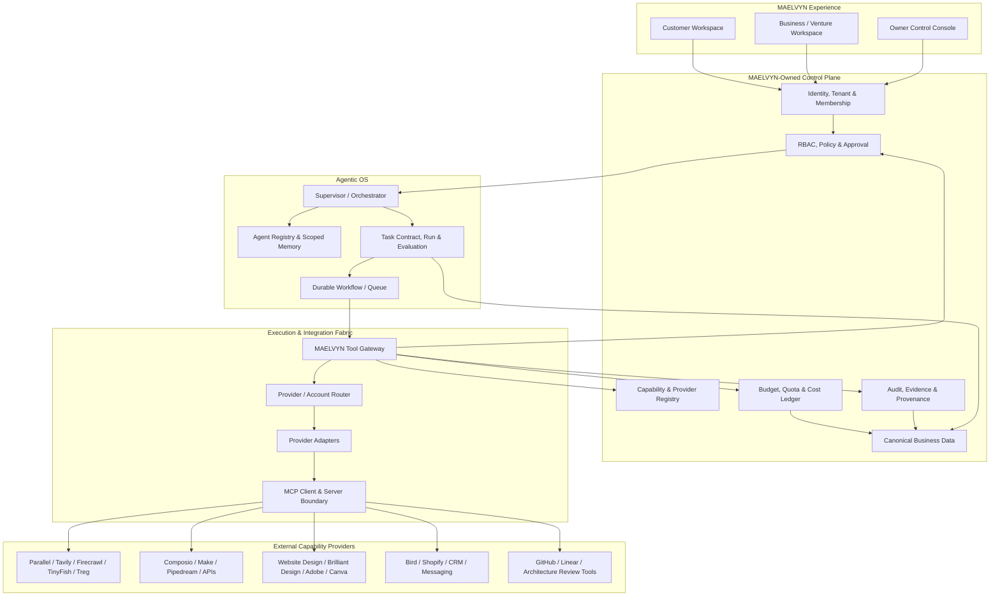

# MAELVYN — External Capability Integration Architecture

**Version:** 1.0.0  
**Status:** Proposed architecture baseline; not production-approved  
**Scope:** Binding external plugins, MCP servers, SaaS APIs, research services, design tools, and automation providers to MAELVYN's internal operating system.  
**Repository:** `Sparkmind-obp-off/Maelvyn`  
**Review date:** 2026-11-25

## 1. Executive decision

MAELVYN must own its business control plane and consume external providers as replaceable capabilities.

**Core principle:** Build the control. Buy the capabilities. Connect the ecosystem. Monetize the outcomes.

External tools must never become MAELVYN's source of truth for identity, authorization, tenant boundaries, business records, finance, ownership, approval, or audit. A provider may perform a bounded task; MAELVYN decides whether the task is allowed, which account it may use, how much it may cost, what data it may receive, and what evidence must be retained.

This document is a proposed binding architecture, not proof that every listed provider is connected to MAELVYN or approved for production use.

## 2. Target architecture



### Ownership boundaries

| Component | Owns | Must not delegate to a provider |
|---|---|---|
| Owner Control | Founder authority, portfolio decisions, capital limits, privileged approvals | Legal/ownership decisions or authority inference |
| MAELVYN Core | Identity mapping, tenants, memberships, RBAC, canonical business data, finance, audit | Identity authority, tenant authorization, financial source of truth |
| Agentic OS | Agent definitions, plans, task contracts, runs, memory scopes, evaluations | Permission grants, reserved approvals, provider credentials |
| Tool Gateway | Tool allowlists, schemas, account routing, cost/quota checks, idempotency, redaction, audit correlation | Policy bypass or direct agent-to-provider access |
| Provider adapters | Translate MAELVYN capability contracts to vendor APIs/MCP tools | Canonical business state or cross-tenant access |
| External providers | Their own API, data, execution and service-specific state | MAELVYN business policy or source-of-truth records |

## 3. Internal capability contract

Agents and business workflows call stable MAELVYN capability names, not vendor-specific tool names.

Examples:

- `research.web.search`
- `research.web.fetch`
- `research.web.deep_research`
- `research.company.enrich`
- `research.web.monitor`
- `design.website.reference`
- `design.website.generate`
- `design.visual.create`
- `design.visual.inspect`
- `automation.workflow.run`
- `communication.email.send`
- `communication.whatsapp.send`
- `commerce.catalog.read`
- `commerce.order.read`
- `engineering.repository.read`
- `engineering.project.track`
- `architecture.review`

A capability contract must define:

1. Stable capability ID and semantic version.
2. Input/output JSON Schema and maximum payload size.
3. Data classification and allowed tenant scopes.
4. Read/write/destructive effect classification.
5. Supported provider adapters and routing priority.
6. Required scopes and connected-account ownership model.
7. Budget unit, quota, rate limit, timeout and retry policy.
8. Idempotency semantics and duplicate handling.
9. Approval class and autonomy ceiling.
10. Provenance, evidence and audit requirements.
11. Health checks, fallback and manual recovery.
12. Commercial terms, data retention and review date.

A provider is not eligible for routing merely because its tool is visible in ChatGPT or its MCP server can be discovered.

## 4. Execution protocol

Every tool call follows this sequence:

1. **Authenticate:** resolve the human or trusted system principal.
2. **Resolve scope:** derive tenant, workspace, venture, user and agent identity from server-side records; never trust model-supplied tenant IDs.
3. **Resolve intent:** load the task contract and requested capability.
4. **Authorize:** check role, data scope, tool allowlist, connected-account ownership and autonomy level.
5. **Check commercial and data policy:** verify provider terms, allowed use, data class, retention and redistribution restrictions.
6. **Check budget and quota:** estimate cost, enforce per-run, per-tenant, per-provider and platform ceilings.
7. **Approve:** require human confirmation for sensitive writes, publishing, outbound communication, deletion, payments, admin changes and legal/ownership actions.
8. **Prepare:** validate schema, redact/minimize inputs, assign correlation and idempotency keys.
9. **Execute:** call the selected adapter; agents never call providers directly.
10. **Verify:** validate provider response, schema, evidence, side effect and expected state.
11. **Persist:** save business outcome, usage/cost, provenance and append-only audit event.
12. **Recover:** retry only retryable failures; pause, escalate or route to a reviewed fallback otherwise.

### Required invariants

- Deny by default; authorize every invocation, not only tool discovery.
- Child agents may receive narrower permissions, never broader permissions than their parent task.
- Provider credentials and refresh tokens never enter prompts, model context, queue payloads, workflow state, user-visible logs or generated artifacts.
- A model choosing a tool is not authorization to execute it.
- A successful HTTP response is not proof that the intended business state changed; verify the outcome.
- Every write must be duplicate-safe. Use an MAELVYN action ID and provider idempotency key where supported.
- Provider-side logs supplement, but do not replace, MAELVYN's own audit record.
- Customer-owned accounts and MAELVYN-owned accounts are distinct records and cannot be substituted silently.
- Cross-tenant access is denied by default, including shared provider accounts.
- Provider outages, revoked credentials, quota exhaustion and terms changes must fail closed for risky actions.

## 5. Account and credential model

Distinguish these entities in MAELVYN:

- **Tenant / Organization:** customer or internal venture boundary.
- **Human User:** authenticated person.
- **Agent Identity:** non-human principal tied to a human owner and scoped task.
- **Provider:** external service/vendor.
- **Provider Integration:** adapter and configuration for a provider.
- **Connected Account:** authorized account or OAuth connection.
- **Credential Reference:** opaque pointer to a secret held by a secure provider/vault; never the secret itself.
- **Capability Grant:** allowed actions, data scope, tenant, account and expiry.
- **Execution Run:** immutable correlation to task, agent, capability, provider, account and outcome.

### BYOC default

For customer workflows, prefer Bring Your Own Connection (BYOC): the customer authorizes their own provider account, and MAELVYN stores only the opaque account reference, scopes, owner, expiry/health metadata and audit events.

For internal MAELVYN workflows, use separately designated MAELVYN-owned accounts with explicit venture/workspace grants. Do not reuse a founder's personal connection as a shared customer credential.

BYOC provider identity is not the same as deploying the MAELVYN application into a customer's cloud account.

## 6. Reference runtime on Cloudflare

| Technology | Responsibility | Adoption rule |
|---|---|---|
| Workers + Hono | Authenticated API and tool-gateway entry point | Existing preferred foundation |
| D1 | Canonical registry, grants, tasks, approvals, usage, audit metadata | Existing source of truth; migrations only after schema audit |
| R2 private | Large evidence and generated artifacts | Private access only; D1 stores metadata/hash/scope |
| Queues | Decoupled dispatch and event processing | Assume at-least-once delivery; handlers must be idempotent |
| Workflows | Long-running runs, checkpoints, retries and human waits | Use for durable multi-step execution |
| Durable Objects | Per-account or per-run coordination, locks and throttling | Add only when serialization/state coordination is required; avoid one global object |
| KV | Cache and non-authoritative rate-limit hints | Never source of truth for finance, approvals or ownership |

Do not add a separate database per provider or business engine. Reuse the existing MAELVYN Core and current migrations after mapping their present tables and constraints.

## 7. Provider adapter model

Use a provider-neutral interface such as:

```ts
interface CapabilityAdapter {
  providerId: string;
  capabilityIds: string[];
  health(): Promise<ProviderHealth>;
  estimate(input: unknown, context: ExecutionContext): Promise<CostEstimate>;
  execute(input: unknown, context: ExecutionContext): Promise<CapabilityResult>;
  cancel?(runId: string, context: ExecutionContext): Promise<CancelResult>;
}
```

The interface is illustrative. Implementation must use the repository's current language, runtime and test conventions.

Adapter implementations must not import business-domain policy. The gateway authorizes; adapters translate and execute. Provider-specific response data is normalized into stable MAELVYN result contracts, with original provider metadata retained only where allowed and necessary.

## 8. Initial provider routing proposal

| Capability family | Primary candidate | Secondary / fallback | Boundary |
|---|---|---|---|
| General web research | Parallel | Tavily, Firecrawl | Search/fetch/research only through gateway |
| Page extraction/crawling | Firecrawl | TinyFish, first-party APIs | Explicit page/credit caps; no broad crawl by default |
| Browser automation | TinyFish | Browser Use / approved browser provider | Read-only first; writes require approval |
| Company/people intelligence | Treg catalog-selected tools / AgentData | Approved first-party data sources | Verify provenance, coverage, accuracy, data rights |
| Website references and design direction | Website Design | Human design review | Design/research output, not production deploy |
| Visual design execution | Brilliant Design | Adobe / Canva | Artifact generation only; IP/license checks |
| App integrations | Composio | Custom MCP / direct provider API | Candidate primary fabric; terms approval required before embedded commercial use |
| Cross-app automation | Cloudflare Workflows | Make / Pipedream | MAELVYN retains task state, approvals and audit |
| Messaging / customer communication | Bird or customer-owned channel API | Email/WhatsApp provider adapter | Draft by default; sending requires customer authorization and policy checks |
| Repository and source control | GitHub | — | MAELVYN-owned repository access; least-privilege installation |
| Project tracking | Linear | GitHub Issues / internal task records | Bind only to the correct MAELVYN workspace/team; current visible Linear connection is not authorized for this project |
| Architecture governance | AI Software Architect workflow | MAELVYN ADR and review process | Advisory/review role; not an autonomous production executor |

Routing is capability-based and replaceable. The table does not authorize use of every provider, create an account connection, or establish a commercial license.

## 9. Commercial and legal eligibility gate

Before enabling a provider for a paid MAELVYN customer workflow, record:

- Provider/API terms and current version/date.
- Commercial use, embedded SaaS, white-label and redistribution rights.
- Whether end customers must authorize their own account or OAuth app.
- Data controller/processor roles, retention, deletion and training policy.
- Geographic restrictions and regulated-data exclusions.
- Quotas, rate limits, cost model, overage and auto-upgrade behavior.
- Provider security posture and incident process.
- Required verification, marketplace review or security assessment.
- Exit path and data portability.

**Composio caution:** public terms contain language that may restrict resale or commercial use of the platform/content. Do not assume that a paid MAELVYN subscription may bundle or resell Composio access. Obtain written confirmation or an agreement explicitly covering embedded SaaS, end-user access, white-labeling and redistribution before enabling that commercial model.

Provider/API terms are separate from the terms of the MAELVYN service. Do not sell raw third-party access by default; sell MAELVYN's own workflow, analysis, delivery and business outcomes, subject to provider terms.

## 10. Rollout plan

### Phase 0 — Registry and contracts
- Inventory existing adapters, tables, routes, secrets and tests.
- Define capability contract, provider record, connected account, grants and execution record.
- Record terms, costs, quotas, data classes and connection status.
- No new provider credentials or paid execution.

### Phase 1 — Read-only research vertical slice
- One authenticated user and one venture scope.
- One research capability through the Tool Gateway.
- Parallel or existing approved research adapter as first route; one fallback only after comparison.
- Store source URLs, timestamps, provider, run ID, usage and evidence.
- Verify tenant isolation, budget stop, timeout, retry and audit.

### Phase 2 — External app read integrations
- Add one customer-authorized connected account.
- Enforce account owner, exact toolkit/tool allowlist, scope and disconnect.
- Validate cross-tenant isolation and revoked-token handling.

### Phase 3 — Human-approved write operations
- Add draft/preview, explicit approval, idempotency, execution evidence and rollback/compensation where possible.
- Start with low-risk actions; keep payments, ownership, legal commitments and destructive admin actions reserved.

### Phase 4 — Multi-provider routing
- Add health/quota/cost-aware selection and fallbacks.
- Measure quality, reliability, latency, actual cost and margin.
- Remove redundant providers unless they provide measured value.

### Phase 5 — Customer-facing capability products
- Expose only approved capabilities through Product, Service and Commerce Engines.
- Customer UI presents MAELVYN outcomes, not raw provider credentials or internal tool inventory.
- Track customer-owned account consent and usage separately from MAELVYN-owned operating accounts.

## 11. Acceptance criteria

The architecture is ready for implementation planning when:

1. Every existing adapter and external provider is mapped to a stable capability ID.
2. Every capability has schema, data class, effect class, account model, cost, quota, approval and audit policy.
3. A provider cannot be called without gateway authorization.
4. A tenant cannot select another tenant's connected account.
5. Credentials are never present in model prompts, run artifacts or ordinary logs.
6. Duplicate queue delivery cannot duplicate a business side effect.
7. Each execution has a durable MAELVYN run and audit record.
8. Provider terms and commercial rights are explicitly reviewed.
9. A read-only end-to-end test proves the first vertical slice.
10. Production write tools remain disabled until human approval and release gates pass.

## 12. Explicit non-goals

- Building a new universal MCP marketplace.
- Treating ChatGPT plugin availability as MAELVYN runtime connectivity.
- Direct agent-to-provider calls that bypass MAELVYN.
- One provider-specific database per integration.
- Blanket L4 autonomy or self-approval.
- Reselling raw API access or provider credentials.
- Enabling paid providers, auto-top-ups, public publishing, messaging campaigns or payments by default.
- Binding Linear to an unrelated workspace/team.

## 13. Evidence and official references

- [Model Context Protocol — Authorization](https://modelcontextprotocol.io/specification/latest/basic/authorization)
- [Model Context Protocol — Security Best Practices](https://modelcontextprotocol.io/docs/tutorials/security/security_best_practices)
- [Model Context Protocol — Tools](https://modelcontextprotocol.io/specification/latest/server/tools)
- [Composio — Authentication](https://docs.composio.dev/docs/authentication)
- [Composio — Connected Accounts](https://docs.composio.dev/docs/auth-configuration/connected-accounts)
- [Composio — Sessions and tool permissions](https://docs.composio.dev/docs/configuring-sessions)
- [Composio — Terms of Service](https://composio.dev/terms)
- [Cloudflare — Workflows](https://developers.cloudflare.com/workflows/)
- [Cloudflare — Workflows rules and retries](https://developers.cloudflare.com/workflows/build/rules-of-workflows/)
- [Cloudflare — Queues delivery guarantees](https://developers.cloudflare.com/queues/reference/delivery-guarantees/)
- [Cloudflare — Queue retries](https://developers.cloudflare.com/queues/configuration/batching-retries/)
- [Cloudflare — Durable Objects architecture guidance](https://developers.cloudflare.com/durable-objects/best-practices/architecture-guidance/)
- [Cloudflare — Worker Secrets](https://developers.cloudflare.com/workers/configuration/secrets/)
- [Slack API Terms](https://api.slack.com/terms/api)
- [Google APIs Terms](https://developers.google.com/terms)
- [Microsoft APIs Terms](https://learn.microsoft.com/en-us/legal/microsoft-apis/terms-of-use)

---

**Change control:** Update this document only with evidence-backed provider status, reviewed commercial terms, tested adapter behavior and a recorded architecture decision. Never mark a provider as production-ready solely because its ChatGPT connector is available.
