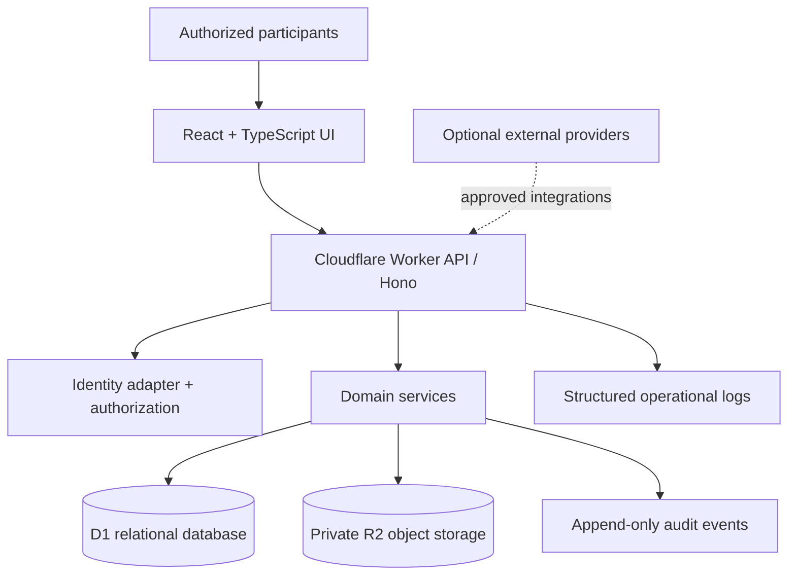

# MAELVYN System Architecture

**Version:** 0.1.0  
**Status:** Proposed technical baseline — not yet production-approved  
**Scope:** Governance, venture portfolio, contributions, approvals, project finance, auditability

## 1. Architecture decision

Build the foundation before the dashboard:

1. Domain model and system boundaries.
2. Relational schema and migration discipline.
3. Backend API, authorization, validation, audit events.
4. Frontend workspace and role-aware views.
5. Integrations and automation only after the core controls are tested.

This order prevents the interface from becoming the source of truth for ownership, approvals, or money.

## 2. Proposed MVP stack

| Layer | Proposed technology | Responsibility |
|---|---|---|
| Web frontend | React + TypeScript + Vite | Workspace, portfolio, approvals, finance views |
| API/runtime | Cloudflare Workers + Hono + TypeScript | Business rules, authorization, API |
| Primary database | Cloudflare D1 (SQLite) | Structured operational records and ledger |
| Private file storage | Cloudflare R2 (later gate) | Signed agreements, receipts, evidence, exports |
| Identity | Provider-neutral identity adapter; choose provider before production | Authentication and external subject mapping |
| Validation | Zod or equivalent | Runtime validation at API boundaries |
| Database access | Typed SQL/repository layer; Drizzle optional | Explicit queries and migration control |
| Observability | Structured logs + audit events | Operational diagnostics and accountability |
| Deployment | Separate development, staging, production environments | Isolation and controlled release |

The Cloudflare/Hono combination is a practical MVP proposal, not a commitment to a specific paid plan. Cloudflare documents D1 bindings for Workers and Hono, and its D1 API supports prepared statements and batch operations. See [D1 Database API](https://developers.cloudflare.com/d1/worker-api/d1-database/) and [Query D1 from Hono](https://developers.cloudflare.com/d1/examples/d1-and-hono/).

## 3. System context

## 4. Bounded contexts

- **Identity & Access:** maps verified identity-provider subjects to MAELVYN people and membership grants. Never trusts a client-supplied role.
- **Governance:** proposals, decision rights, approvals, votes, conflicts, and decision records.
- **Portfolio:** venture records, lifecycle stages, charters, responsible operators, and risk status.
- **Contribution & Rights:** contribution records, agreements, licenses, and separately recorded ownership interests.
- **Finance:** budgets, accounts, journal entries, receipts, expenses, liabilities, reserves, and reports.
- **Assets & Documents:** asset register and private evidence/document metadata.
- **Audit & Reporting:** append-only business audit trail and read models.

## 5. Trust boundaries and invariants

1. Every API request is authenticated before accessing private workspace data.
2. Every record is scoped to a workspace and, where relevant, a venture.
3. Authorization is checked server-side for every read and write.
4. A contribution is not automatically an ownership interest.
5. An ownership interest is not effective until the required agreement and approvals are recorded.
6. No default equal split, no inferred consent, and no automatic inclusion of pre-existing ventures or assets.
7. A budget approval is not a cash transfer. Payment execution remains a separate controlled action.
8. Posted journal entries are immutable. Corrections use reversal entries, never silent edits.
9. Financial records use integer minor units (IDR rupiah as whole units) and explicit ISO currency codes.
10. Audit events record actor, action, target, timestamp, request ID, and minimal change metadata; never store passwords, secrets, or full payment credentials.
11. Destructive deletion is disabled for financial, agreement, ownership, approval, and audit records. Use void, supersede, archive, or reversal workflows.
12. Automation may prepare a proposal; it cannot self-approve a reserved matter.

## 6. Core data flow

### Venture intake
Opportunity → validation evidence → venture charter draft → human review → approved pilot → venture record.

### Contribution and rights
Proposed contribution → classification (loan/service/license/asset/capital/etc.) → valuation method/evidence → agreement → approval → accepted contribution record. Ownership is a separate record and requires an explicit executed agreement.

### Spending
Expense proposal → budget check → required approvals → payment performed outside or through a separately approved payment integration → evidence attached → ledger posting → audit event.

### Finance posting
A journal entry is drafted with at least two lines. The backend validates that total debits equal total credits in the same currency, validates account/venture scope, then posts the entry atomically. Posted entries cannot be edited or deleted.

## 7. API shape

Base path: `/api/v1`

- `/session` — current authenticated principal and effective grants
- `/workspaces` — workspace metadata and membership
- `/ventures` — venture records, charter, lifecycle, risk
- `/contributions` — proposed and accepted contributions
- `/agreements` — agreement metadata and execution status
- `/ownership-interests` — explicitly agreed rights register
- `/approvals` — requests, required approvers, votes, decisions
- `/budgets` — versions, caps, and variance
- `/finance/accounts` — chart of accounts
- `/finance/journals` — draft and posted journal entries
- `/assets` — productive asset register
- `/audit-events` — restricted audit search/export

Use cursor pagination, stable IDs, ISO-8601 timestamps, explicit currency codes, idempotency keys for write operations, and structured error codes. Never accept a workspace ID as proof of authorization.

## 8. MVP modules and release gates

### Phase A — Foundation
- Identity adapter and workspace membership.
- Role/permission matrix.
- Venture registry and charter.
- Agreements, contributions, ownership register.
- Approval workflow and audit trail.
- Database migrations, seed-free production setup, backup/export procedure.

**Gate:** access-control tests pass; personal and pre-existing assets are not imported by default.

### Phase B — Financial control
- Chart of accounts per venture.
- Double-entry journal.
- Budget versions and spending approvals.
- Receipt/document metadata.
- Cash, payable, receivable, reserve, and monthly reporting views.

**Gate:** ledger invariants, reversal flow, and reconciliation tests pass.

### Phase C — Frontend workspace
- Overview dashboard.
- Venture detail and lifecycle board.
- Contribution/rights register.
- Approval inbox.
- Finance ledger and budget screens.
- Audit history.

**Gate:** UI reflects server-authoritative permissions and state; no client-only approval logic.

### Phase D — Integrations
Only add accounting exports, payment providers, automation, or AI agents after data ownership, scopes, consent, provider terms, and failure handling are documented.

## 9. Environment and deployment rules

- Separate D1 databases and secrets per environment.
- No production data in development or preview.
- Apply reviewed, versioned SQL migrations; never edit production schema manually.
- Use least-privilege API tokens and rotate credentials.
- Keep R2 buckets private; use short-lived authorized downloads for sensitive files.
- Do not expose environment secrets to Vite/browser bundles.
- Back up/export critical records and test restore before launch.
- Production launch requires legal review of the actual operating model, privacy/terms review, access-control testing, and a documented incident process.

## 10. Explicit non-goals for the first release

- Public investment solicitation or investment marketplace.
- Automatic profit-sharing or dividend calculations as legally binding entitlements.
- Automatic transfer of existing businesses, domains, IP, bank accounts, or assets.
- Custody of participant funds or pooled wallet.
- Autonomous AI approval of loans, investments, ownership changes, or payments.
- Public signup without invitation and verified authorization.

## 11. Open decisions before production

- Legal operator and jurisdiction-specific entity structure.
- Actual participants and their agreed roles (no one is presumed to participate).
- Identity provider and account recovery model.
- Whether financial data is operational management data or must integrate with formal accounting software.
- Document retention, privacy notices, and data-subject request handling.
- Approval thresholds and reserved matters, approved per venture.
- Production budget, service limits, recovery objectives, and operational owner.
